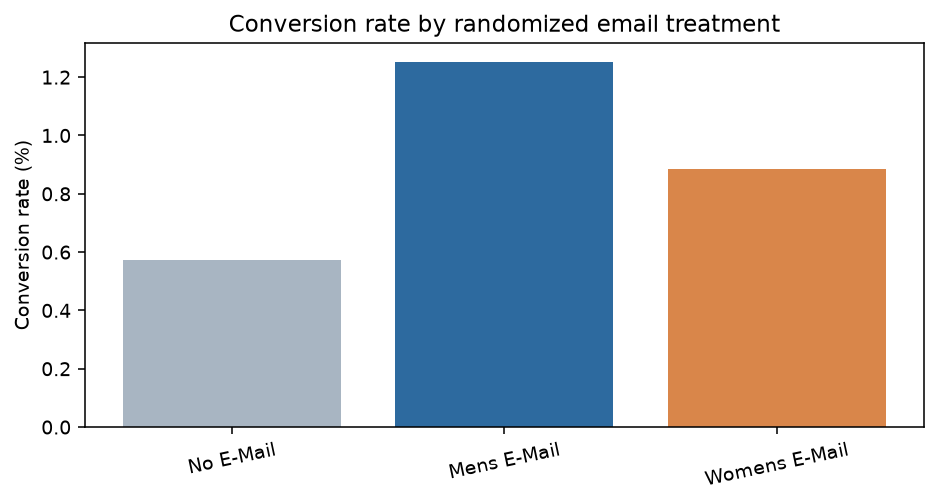

# 项目一：营销投放增量与因果分析

## 1. 业务背景与初步洞察

营销团队通常能看到“发过邮件的人买了多少”，但这不能回答邮件是否真正带来了增量。没有邮件的人也可能自然购买；如果把发送后的全部销售额归因给邮件，预算会被高估。

因此，本项目从一个更接近实际经营的问题开始：**邮件营销是否带来超出自然购买的增量访问、购买和收入？如果要扩量，男装邮件、女装邮件和选择性投放应该如何排序？**

## 2. 为什么选择这个数据集

我选择 Hillstrom Email Marketing Dataset，而不是普通的订单明细数据，原因是它包含一个公开的三组随机营销实验：客户被分到男装邮件、女装邮件或不发邮件。它同时有处理变量、访问、购买、消费金额和投放前客户特征，能够支持从描述性分析走到因果效果和商业 ROI，而不只是做相关性报表。

数据共 **64,000 名客户**，三组规模接近：不发邮件 21,306、男装邮件 21,307、女装邮件 21,387。关键字段包括 `visit`、`conversion`、`spend`、`history`、`history_segment`、`newbie` 和 `channel`。数据没有缺失值。

来源：[MineThatData 原始说明](https://blog.minethatdata.com/2008/03/minethatdata-e-mail-analytics-and-data-mining-challenge.html) · [CSV](http://www.minethatdata.com/Kevin_Hillstrom_MineThatData_E-MailAnalytics_DataMiningChallenge_2008.03.20.csv)

## 3. 问题、假设与指标

### 核心问题

1. 两种邮件是否提高访问率和转化率？
2. 邮件带来的增量收入是否足以覆盖成本？
3. 不同历史消费、用户类型和渠道的效果是否不同？

### 假设

- H1：男装邮件相对不发邮件提高访问率和转化率。
- H2：女装邮件相对不发邮件提高访问率和转化率。
- H3：处理效应在不同客户分层之间存在差异。

### 指标口径

| 指标 | 定义 | 业务含义 |
|---|---|---|
| Visit rate | `visit / customers` | 邮件带来的访问增量 |
| Conversion rate | `conversion / customers` | 客户层面的购买概率 |
| 客均消费 | `spend / customers` | 每触达客户带来的收入 |
| 增量利润 | `客均消费增量 × 毛利率 - 邮件成本` | 是否值得扩量 |

分析采用客户级 ITT（按随机分配比较），不把“打开邮件”或“访问网站”当成处理条件，避免产生选择偏差。

## 4. 分析方法与验证

### 数据质量与随机性检查

先检查字段类型、缺失值、重复值和三组样本量。对 `recency`、`history`、`mens`、`womens`、`newbie` 以及历史消费、地区、渠道等投放前变量计算标准化均值差异（SMD）。两种邮件组相对控制组的最大绝对 SMD 分别约为 **0.016** 和 **0.014**，支持三组在投放前具有较好的可比性。

### 总体处理效应

以不发邮件组为控制组，计算访问率、转化率和客均消费差异；访问率和转化率使用两比例比较，客均消费使用 Welch 检验；对客均消费差异使用 1,200 次客户级 Bootstrap 生成 95% 区间。

### 异质性分析

按 `history_segment`、`newbie` 和 `channel` 分组，重新计算处理组与控制组差异。分层结果用于提出下一轮实验假设，不直接把探索性差异当作永久定向规则。

### 经济测算

`spend` 代表收入而不是利润，因此设置毛利率 20%、40%、60%和邮件成本 $0.01、$0.05、$0.10 的情景，计算增量利润和 ROI。所有假设写入 `economic_scenarios.csv`，避免把模型假设伪装成观测事实。

## 5. 结果与洞察

- 男装邮件访问率提升 **7.66 个百分点**，转化率提升 **0.681 个百分点**，客均消费增量约 **$0.772**；客均消费增量的 Bootstrap 95% CI 为 **[$0.487, $1.056]**。
- 女装邮件访问率提升 **4.52 个百分点**，转化率提升 **0.311 个百分点**，客均消费增量约 **$0.424**；Bootstrap 95% CI 为 **[$0.146, $0.681]**。
- 在 40% 毛利率、每封邮件成本 $0.05 的情景下，两种邮件的模型增量利润均为正；当女装邮件成本升到 $0.10 时，模型增量利润转负。
- 历史消费分层显示男装邮件在多个消费区间保持正向；女装邮件在部分中间消费段较弱，说明总体平均效果不能直接替代客户定向策略。

## 6. 商业结论与行动建议

1. 男装邮件可以进入更大规模的验证，优先确认毛利、退货和长期复购是否抵消短期收入增量。
2. 女装邮件不建议仅凭总体平均效果全量扩张，优先按历史消费和商品偏好做定向 A/B 测试。
3. 下一轮实验应预先注册主指标、保护指标和停止规则；主指标建议使用增量毛利或客均贡献利润，而不是单独看访问率。

## 7. 局限性

- 实验发生于 2008 年，不能直接外推到当前渠道和用户结构。
- `spend` 是收入，不是利润；真实 ROI 需要邮件成本、毛利、退货、退订和长期价值。
- 分层结果是探索性的，需要新的独立实验验证。

## 8. 复现与证据

- [Python 分析脚本](src/analyze_hillstrom.py)
- [SQL 查询](sql/analysis.sql)
- [组间统计](results/group_summary.csv)
- [处理效应](results/effect_vs_control.csv)
- [随机性平衡检查](results/balance_check.csv)
- [客户分层](results/subgroup_effects.csv)
- [经济情景](results/economic_scenarios.csv)
- [项目复现说明](README.md)

