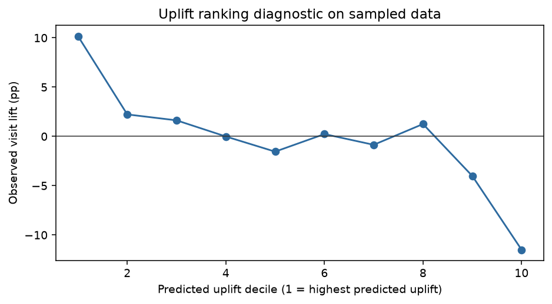

# 项目二：广告投放增量建模与用户分层

## 1. 业务背景与初步洞察

广告团队面对的不是“谁更容易转化”，而是“谁会因为广告而额外转化”。如果只训练转化预测模型，模型可能把原本就会访问的用户排在前面，导致预算浪费和广告疲劳。

因此，本项目从预算决策出发：**在广告预算有限时，哪些用户更可能因为处理而增加访问？总体投放效果是否足以支持扩量？**

## 2. 为什么选择这个数据集

Criteo Uplift Prediction Dataset 是广告 uplift 建模的公开基准，字段同时包含匿名用户特征、`treatment`、`visit`、`conversion` 和 `exposure`。它比普通广告点击数据更适合研究增量，因为 treatment 和结果变量在同一张表中，可以把“预测谁会转化”和“预测谁会因广告改变行为”区分开。

官方数据约 **1,397.9 万行**，但完整压缩文件较大且不适合直接放进公开仓库。本项目通过 Hugging Face 数据查看接口，在全量行索引上等间距抽取 50 页、共 **5,000 行真实记录**，并保存抽样规则。结果用于展示完整分析流程，不代表全量数据估计。

来源：[Criteo AI Lab 数据说明](https://ailab.criteo.com/criteo-uplift-prediction-dataset/)

## 3. 问题、假设与指标

### 核心问题

1. treatment 对访问率和转化率的平均影响是多少？
2. 高预测 uplift 人群是否比随机投放人群更值得优先触达？
3. 如何把 uplift 排名转成下一轮实验，而不是直接当成生产规则？

### 假设

- H1：处理组的访问率高于控制组。
- H2：处理组的转化率高于控制组，但低频转化需要更大样本才能稳定判断。
- H3：处理效应在匿名特征分布不同的用户之间存在异质性。

### 指标口径

| 指标 | 定义 | 业务含义 |
|---|---|---|
| Visit rate | `visit / rows` | 广告带来的访问增量 |
| Conversion rate | `conversion / rows` | 最终转化增量 |
| Exposure rate | `exposure / rows` | 实际曝光状态，不等于收益 |
| Uplift | `P(Y|x,t=1)-P(Y|x,t=0)` | 同一用户接受与不接受处理的预测差异 |

## 4. 数据处理与方法选择

### 数据抽样与质量检查

抽样脚本固定 50 个行索引位置，每个位置取 100 行，去重后保留 5,000 行。保留 `sample_metadata.json`，记录全量行数、接口、页数和抽样规则。样本处理比例约 84%，与官方数据的处理比例接近；但抽样并非完整随机抽样，结论必须标记为样本诊断。

### 总体处理效应

先按 treatment 分组计算 visit、conversion 和 exposure 率，再使用两比例差异和近似 95% 区间。这个步骤先回答“平均上有没有信号”，不急于上模型。

### 为什么使用 T-learner

如果直接训练一个转化预测模型，它优化的是 `P(Y|X)`，不一定能识别处理增量。本项目分别在处理组和控制组训练逻辑回归模型，得到：

```text
predicted uplift = P(visit | X, treatment=1) - P(visit | X, treatment=0)
```

再按预测 uplift 分十组，比较每组真实处理组与控制组的访问差异。由于样本只有 5,000 行且转化极为稀疏，分层结果只作为下一轮随机实验的候选排序，不作为上线策略。

## 5. 结果与洞察

- 样本处理组访问率约 **4.40%**，控制组约 **3.88%**，差异约 **+0.53 个百分点**；近似 95% 区间为 **[-0.94, +2.00] 个百分点**，当前样本不能确认访问提升。
- 处理组转化率约 **0.191%**，控制组约 **0.125%**，差异约 **+0.065 个百分点**；区间为 **[-0.213, +0.344] 个百分点**，不能据此确认转化增量。
- 处理组曝光率约 **3.74%**，控制组为 0，这是字段定义造成的处理状态差异，不等于广告利润。
- T-learner 分层中，最高预测 uplift 的前 20% 观察到正向访问差异，最低分层观察到负向差异；但分层波动明显，说明需要全量数据、交叉验证和独立实验验证。



## 6. 商业结论与行动建议

1. 当前样本不支持直接扩张广告预算；先在全量数据上复现平均处理效应并完成样本量/功效检查。
2. 将高 uplift 前 10%至20%作为下一轮随机实验的候选人群，设置随机 holdout，比较增量访问、增量转化和增量毛利。
3. 预算决策必须纳入 CPM/CPC、毛利、频控、退订、长期留存和广告疲劳；visit uplift 不能直接等于利润。
4. 生产模型需要独立时间切分、稳定性监控和模型漂移检查，避免把样本中的偶然排序当成定向规则。

## 7. 局限性

- 本报告使用 5,000 行索引样本，不代表官方全量数据。
- 官方数据经过隐私相关抽样处理，原始广告增量水平不能直接从样本外推。
- 匿名特征缺乏可解释业务含义，模型只能用于排序，不能直接形成产品或渠道策略解释。
- 逻辑回归 T-learner 是基线方法，不等于生产级 uplift 模型；需要交叉拟合、样本外 Qini/AUUC 和成本敏感性验证。

## 8. 复现与证据

- [样本抽取脚本](src/fetch_criteo_sample.py)
- [分析脚本](src/analyze_criteo.py)
- [SQL 查询](sql/analysis.sql)
- [样本元数据](data/sample_metadata.json)
- [处理组统计](results/treatment_summary.csv)
- [总体处理效应](results/average_treatment_effects.csv)
- [uplift 分层](results/uplift_deciles.csv)
- [项目复现说明](README.md)

