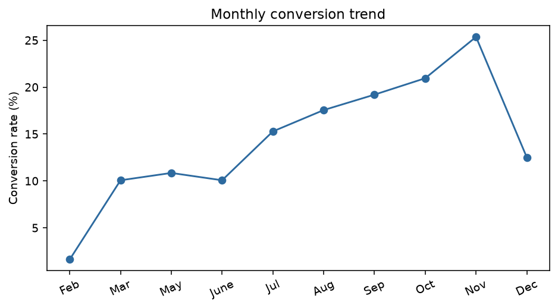

# 项目三：电商转化漏斗与用户行为分析

## 1. 业务背景与初步洞察

电商团队经常看到“本月转化率下降”，但单一总指标不能说明问题发生在哪个环节：可能是流量质量变化、页面浏览深度不足、退出率上升、季节性变化，也可能只是用户结构不同。

因此，本项目从经营诊断出发：**哪些用户场景和站内行为与购买转化最相关？产品、运营和再营销团队应该优先优化什么？**

## 2. 为什么选择这个数据集

UCI Online Shoppers Purchasing Intention Dataset 是一个适合练习电商经营分析的会话级数据集，共 **12,330 次网站会话**，包含页面访问次数、页面停留时间、跳出率、退出率、PageValues、月份、用户类型、周末和最终购买标记 `Revenue`。

它适合回答“转化发生在哪里、哪些信号能帮助排序”，也适合构建 SQL 指标和经营看板。它没有随机处理组，因此我明确把它定位为描述性/预测性分析，不把相关关系包装成因果关系。

来源：[UCI Online Shoppers Purchasing Intention Dataset](https://archive.ics.uci.edu/dataset/468/online+shoppers+purchasing+intention+dataset)

## 3. 问题、假设与指标

### 核心问题

1. 新访客和回访访客的转化差异有多大？
2. 月份、周末和页面行为是否造成经营指标结构性差异？
3. 能否用会话行为给再营销或运营团队做优先级排序？

### 假设

- H1：产品页浏览深度和 PageValues 较高的会话具有更高转化概率。
- H2：退出率和跳出率较高的会话转化概率较低。
- H3：月份和用户类型会改变转化基线，经营看板需要分层而不是只看总转化率。

### 指标口径

| 指标 | 定义 | 业务用途 |
|---|---|---|
| Session conversion | `Revenue=True / sessions` | 网站整体转化 |
| Product depth | `ProductRelated` | 产品浏览深度 |
| Product duration | `ProductRelated_Duration` | 产品页停留 |
| Exit rate | 数据集提供的会话退出率 | 页面流失信号 |
| PageValues | 数据集提供的页面价值 | 高意向/高价值信号 |

## 4. 分析方法与验证

### 数据质量与描述性拆解

把 `Revenue` 和 `Weekend` 转为二元变量，确认 18 个字段类型和目标变量比例；按 `VisitorType`、`Month` 和 `Weekend` 分组，输出会话数、购买数、转化率、PageValues 和退出率。

### 行为画像

比较买家和非买家的产品页访问次数、产品页停留、跳出率、退出率和 PageValues。这一步用于形成可解释的经营假设，例如“高退出率页面可能需要优化信息承接”，但不直接声称这些行为导致购买。

### 预测排序

使用数值变量标准化、类别变量 one-hot 和逻辑回归，留出 25% 测试集并按 Revenue 分层。报告 ROC-AUC、Average Precision 和 Brier Score；另外按模型分数排序，计算前 5%、10%、20%、30%、50%会话的转化率和买家覆盖率，回答“如果只能优先触达一部分会话，排序是否有价值”。

## 5. 结果与洞察

- 新访客转化率约 **24.9%**，回访访客约 **13.9%**；这说明“回访”本身不能简单等价为高价值用户，需要结合页面行为进一步分层。
- 月度转化率差异明显：11 月约 **25.4%**，2 月约 **1.6%**；促销季节性、流量结构或数据采集周期都可能影响总指标。
- 买家平均浏览产品页约 **48.2** 页、产品页停留约 **1,876 秒**；非买家分别约 **28.7** 页和 **1,070 秒**。
- 买家平均 PageValues 约 **27.3**，非买家约 **2.0**；买家退出率和跳出率也更低。
- 逻辑回归在留出测试集上的 ROC-AUC 约 **0.897**，Average Precision 约 **0.620**，Brier Score 约 **0.124**。
- 在测试集上，模型分数最高的前 10% 会话转化率约 **67.6%**，约覆盖测试集中 **43.8%** 的买家；这说明排序可用于再营销优先级，但不代表对这些用户采取动作会产生因果增量。

## 6. 商业结论与行动建议

1. 经营看板应该同时展示总体转化率、用户类型、月份、PageValues、产品页深度和退出率，避免只看一个总数。
2. 将 PageValues、产品页深度和退出率作为再营销候选排序信号；预算不足时先验证高分会话的增量价值。
3. 11 月等高意向月份重点准备库存、客服和落地页承接；2 月等低转化月份先排查流量来源、页面匹配和数据口径。
4. 对页面改版、推荐模块或再营销策略设计 A/B 测试，使用增量转化、增量毛利和退款率作为主要/保护指标。

## 7. 局限性

- 数据没有随机处理组，所有行为差异都不能直接解释为因果关系。
- 数据集没有订单金额、成本、渠道投放成本和长期价值，因此不能直接计算 ROI。
- 数据是历史会话截面，模型在其他时期或其他网站上的表现需要重新验证。
- 逻辑回归是可解释基线，不代表生产系统的最终模型；上线前要做时间切分、概率校准和漂移监控。

## 8. 复现与证据

- [Python 分析脚本](src/analyze_uci_shoppers.py)
- [SQL 查询](sql/analysis.sql)
- [访客类型统计](results/visitor_type_summary.csv)
- [月度统计](results/month_summary.csv)
- [买家行为](results/buyer_behavior_summary.csv)
- [模型指标](results/model_metrics.json)
- [预测排序阈值](results/targeting_thresholds.csv)
- [项目复现说明](README.md)
